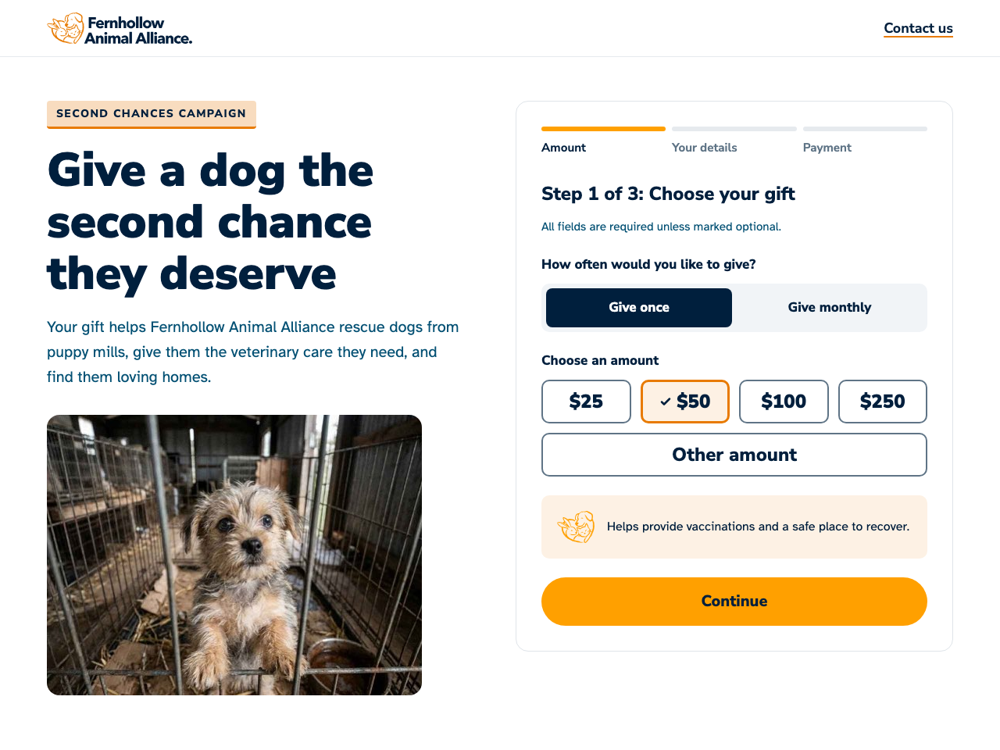

# Fernhollow Animal Alliance: donation form

A multi-step donation form for a fictional animal charity, built with plain HTML, CSS and JavaScript. No framework, no build step, no third-party scripts.

**[Try the live demo](https://shadelourens.github.io/fernhollow-portfolio/)**. Use the test card `4242 4242 4242 4242` with any future expiry date and any 3-digit CVC. No payment is processed.

Built by **Shade Lourens** · [LinkedIn](https://www.linkedin.com/in/shadelourens)

> Fernhollow Animal Alliance is fictional, created for this portfolio.



## What it does

1. **Choose your gift:** give once or monthly, preset amounts or your own, with a message showing what each amount does.
2. **Your details:** name, email, country and postal code, with an email opt-in that's unticked by default.
3. **Payment:** a demo card form with an optional processing fee (2.9% + $0.30) and the total on the Give button.
4. **Thank you:** the donor's name and total, what their gift does, a petition card, Copy link, an updates sign-up and Restart demo.

There's also an **A/B test** on the headline: add `?v=b` to the address to see variant B.

## Accessibility

Built to WCAG 2.2 AA from the start, not checked at the end.

- Real radio buttons, labels, fieldsets and legends, so it works with a keyboard and screen readers without extra code.
- Errors are shown in words under each field, with an icon and a hidden "Error:" for screen readers, so they never rely on color.
- With more than one error, a summary box appears with links that jump to each field.
- Focus moves to each new step's heading, and status messages are announced ("Processing your gift…", "Link copied").
- Brand colors only, with every text pair at 4.5:1 or more. Orange is used only for decoration, never text.
- Buttons and options are well over the 24px minimum tap size, and nothing sticky covers a focused element (both new in WCAG 2.2).
- Works on a 320px phone, at 200% zoom, and respects reduced motion.

## Testing

| Check | Result | Proof |
|---|---|---|
| Keyboard only | Every step, the errors and the thank-you step work without a mouse | Tested by hand |
| Screen reader | Tested with VoiceOver in Safari | Tested by hand |
| Lighthouse (mobile, live site) | 100 for Performance, Accessibility, Best Practices and SEO | [Scores](testing-screenshots/live-lighthouse-scores.png) |
| axe DevTools | 0 issues on steps 1, 2 and 3, the thank-you step, and step 2 with errors showing | [Step 1](testing-screenshots/axe-step1.png) · [Step 2](testing-screenshots/axe-step2.png) · [Step 2 with errors](testing-screenshots/axe-step2-with-errors.png) · [Step 3](testing-screenshots/live-axe-step3.png) · [Thank you](testing-screenshots/live-axe-thank-you.png) |

The free version of axe checks the WCAG 2.1 AA rules. I checked the rules added in 2.2 (like tap size and focus not being hidden) by hand.

More screenshots, including phone layouts and error states, are in [`testing-screenshots/`](testing-screenshots/).

## Decisions worth mentioning

- **No third-party scripts.** The payment card security standard, PCI DSS v4 (requirement 6.4.3), says every script on a payment page must be authorized and monitored. With none, there's nothing to track.
- **Card details are never sent or stored.** The card fields have no `name`, so the browser can never include them in a form submission, and they're emptied after payment.
- **Fees are worked out in whole cents**, so rounding is always exact.
- **The shared link drops `?v=b`**, so friends aren't all put into one A/B group.
- **The impact line repeats on the thank-you step**, telling donors what their money does straight after they give.
- **The petition button says "(demo)"** and explains there's no petition page, instead of linking nowhere.

## How I built it

**Brand first.** I came up with Fernhollow Animal Alliance and designed its logos, color palette and brand identity myself. I gave those designs to Claude Code as visual reference before any development started.

**Then the build, with Claude Code** as my AI coding assistant. For each part I:

1. asked Claude for a plan in plain words
2. reviewed it, made the design and accessibility calls, and approved it
3. let Claude write the code, then tested it myself with a keyboard, VoiceOver, axe and Lighthouse.

Working this way let me move quickly while keeping every decision my own. The build commits from step 2 onward are co-authored with Claude, so the history shows how the work was done. [`NOTES.md`](NOTES.md) records what I asked for and why I made each decision. [`CLAUDE.md`](CLAUDE.md) holds the project rules I gave Claude, like "clear over clever" and the brand and accessibility rules.

## What I'd do next

- **A petition page** that feeds into the donation form, so signers are asked to give next.
- **A real payment provider's hosted card fields**, so card details never touch the page at all.
- **A proper A/B testing tool** instead of `?v=b`, with random assignment and results tracking.

## Files

```
index.html             the page
styles.css             all the styling, with brand colors as CSS variables
script.js              steps, validation and the fake payment
assets/                logos, photos and fonts
testing-screenshots/   Lighthouse, axe and layout screenshots
NOTES.md               my working notes
CLAUDE.md              project rules for Claude Code
```

## Credits

- Fonts: [Nunito Sans](https://fonts.google.com/specimen/Nunito+Sans) and [Atkinson Hyperlegible](https://www.brailleinstitute.org/freefont/), both under the SIL Open Font License.
- Photo of Biscuit: AI-generated with Google Gemini, so the page doesn't use a real charity's photos or a real animal. Biscuit, like Fernhollow, is fictional.
